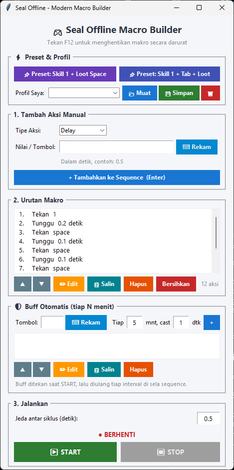

# Seal Offline Macro Builder

Makro keyboard dengan UI untuk Seal Offline: susun urutan tombol & delay, tambahkan buff otomatis per interval, lalu simpan sebagai profil.



## Fitur

- Sequence tombol & delay: tambah, edit, urutkan, salin, hapus (bisa pilih banyak dengan Ctrl/Shift + klik).
- Rekam tombol langsung dari keyboard.
- Buff otomatis: tombol yang ditekan tiap N menit di sela sequence.
- Preset bawaan dan profil sendiri (disimpan di `profiles.json`).
- **F11** = Start/Stop langsung dari dalam game, **F12** = stop darurat.
- Klik START memberi hitung mundur 3 detik untuk pindah ke jendela game.

## Cara Pakai

**Tanpa Python:** jalankan `MacroSeal.exe`. Profil tersimpan di `profiles.json` di folder yang sama dengan `.exe`.

**Dengan Python:** double-click `run.bat`. Dependensi (`keyboard`, `pynput`) terpasang otomatis saat pertama kali dijalankan.

Atau manual:

```
pip install keyboard pynput
python script.py
```

Jalankan sebagai Administrator jika tombol tidak terbaca di dalam game.

## Build .exe

Double-click `build.bat`. Hasilnya di `dist\MacroSeal.exe`.
